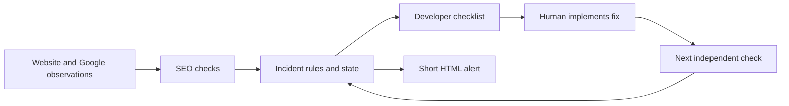

# SEO Incident Monitor

**Catch technical SEO problems early, turn them into clear tasks, and verify that fixes actually work.**

A portfolio demonstration of a technical SEO operations system for a fictional education website. It shows how automated monitoring can protect the path from organic search to enquiry or application, reduce repetitive audits, and give developers a clear queue of work.

## Why this matters

A broken application page, accidental noindex directive or failed redirect can interrupt acquisition without anyone noticing. Manual checks consume time; long audit reports also make it difficult to decide what to fix first. This system automates detection, prioritization, reporting and follow-up, while leaving website changes with the responsible team.

| Business objective | What the automation does | KPI to measure in production |
| --- | --- | --- |
| Protect acquisition | Detect unavailable or non-indexable public pages, broken links and redirect errors | Incident detection time; affected organic landing sessions |
| Reduce manual effort | Check repeated signals automatically and produce a short HTML brief | Analyst minutes per monitoring cycle |
| Speed up remediation | Provide evidence, suggested owner, fix and acceptance criteria | Median time from detection to verified resolution |
| Avoid repeated work | Deduplicate notifications and preserve developer notes | Duplicate alerts; open task age |

## See the evidence first

All numbers below come from a **fictional test**, not client performance or revenue results. The output files are generated by running the included code.

| Scenario | Actual demo result |
| --- | --- |
| Initial incident | 36 checks attempted, 26 known; 8 open flags detected |
| Repeat with unchanged inputs | 0 duplicate pending alerts after simulated delivery acknowledgement |
| Recovery | 7 issues independently verified fixed; 1 indexing issue remains open |
| Human collaboration | Checkbox, assignee and implementation notes preserved |
| Automated tests | 8 passing tests |

- [See the short HTML incident brief](evidence/incident-brief.html) (download and open in a browser).
- [See the developer's editable CSV checklist](evidence/incident-checklist.csv).
- [See the recovery checklist](evidence/recovery-checklist.csv) and [recovery brief](evidence/recovery-brief.html).
- [See the machine-readable execution summary](evidence/run-summary.json) and [local test transcript](evidence/test-transcript.txt).

The real production design behind this independent demonstration was deployed and exercised against an actual website with scheduled n8n monitors, Google API checks, spreadsheet task synchronization, verified Gmail sends and named editor access. Private production logs, customer identifiers, live URLs, credentials, internal workflow exports and actual SEO measurements are deliberately excluded. The public version is a new, smaller implementation using synthetic observations; it does not claim to reproduce every production rule.

## How it works



| Stage | Purpose |
| --- | --- |
| Collect | Production uses public HTTP, sitemap/robots, GSC URL Inspection, mobile PageSpeed and TLS probes. The demo reads fictional JSON snapshots instead. |
| Evaluate | Classify HTTP failures, noindex, canonical, broken links, redirects, indexing, CWV, robots, TLS, metadata and content/schema observations. Missing data stays unknown. |
| Route | Create a stable issue identity, priority, evidence, fix, verification and owner. The production destination is Google Sheets and Gmail; the demo generates CSV and HTML. |
| Verify | Only a successful independent observation resolves a flag. A human checkbox records implementation progress, not technical proof. |
| Report | Show new and fixed issues, coverage, custom health and three top actions. |

## Run the demo (no account or API key required)

Install Node.js 20 or newer. From this repository:

```bash
npm test
npm run demo
npm run workflow
```

Open `evidence/incident-brief.html` in a browser and `evidence/incident-checklist.csv` in your spreadsheet app. Run the recovery example and compare its checklist. The included fixtures use the reserved `.example` domain, and the scripts do not contact it or any external service.

### Run the n8n version

1. In your own n8n instance, choose **Import from file** and select [`workflows/fictional-demo.json`](workflows/fictional-demo.json).
2. Leave the workflow inactive and click **Execute workflow** manually.
3. Inspect the output of **Detect, deduplicate and verify fixes**. It contains the HTML, checklist CSV and incident/repeat/recovery results.

No credentials, real email sends or production writes are included in the demo. The exact embedded JavaScript was executed locally as a parity test; the supplied JSON has not been imported and run on an external n8n instance as part of this public release.

### Continuous quality checks

The GitHub Actions workflow runs tests, regenerates evidence and checks that generated artifacts match committed versions on pushes, pull requests, manual runs and a weekly schedule. CI is a regression test against synthetic data, not a live website monitor. See the repository's **Actions** tab after publishing to verify actual hosted executions.

## Business impact: measure, do not invent

Illustrative time model for a 50-page monitoring cycle:

- Manual checking: 50 pages × 2 minutes = 100 minutes.
- Manual report preparation: 15 minutes.
- Automated exception review: 15 minutes.
- Estimated time saved: 100 minutes per cycle (87% of the assumed 115 minutes), excluding remediation.

 Replace them with stopwatch measurements from comparable manual and automated runs. The [measurement guide](docs/business-impact.md) includes the calculation and a framework to connect incident duration with affected landing sessions, enquiries and applications. Revenue protected cannot be claimed without attributable downstream data.

## Technical decisions

- Read-only monitoring; no automatic site changes or indexing requests.
- Missing field metrics and failed fetches do not become successful observations.
- Good field CWV thresholds: LCP ≤ 2,500 ms; INP ≤ 200 ms; CLS ≤ 0.10.
- Seven-day indexing review window; review schema against intended visible content.
- Stable issue identity, delivery acknowledgement, repeat suppression, re-open logic and independent verification.
- HTML escaping and CSV formula-injection protection.
- Demo health is a simple known-check pass rate, suppressed below 70% coverage and capped at 69 with critical open incidents. It is not a Google score; production uses weighted categories instead.

See [production architecture and rollout](docs/architecture.md) and [evidence limitations](docs/evidence.md).

## Repository map

```text
src/engine.js             Detection, issue lifecycle and reporting
src/demo.js               Reproducible incident/recovery scenario
src/build-workflow.js     Generate and check n8n import JSON
fixtures/                 Fictional observations
workflows/                Safe manual n8n demo
tests/                    Regression tests
evidence/                 Generated reports and execution evidence
docs/                     Architecture, limitations and impact measurement
.github/workflows/        CI and weekly regression check
```

**Portfolio focus:** Technical SEO, JavaScript, n8n workflow design, API integration architecture, issue management, human review, QA and measurable operational outcomes.
